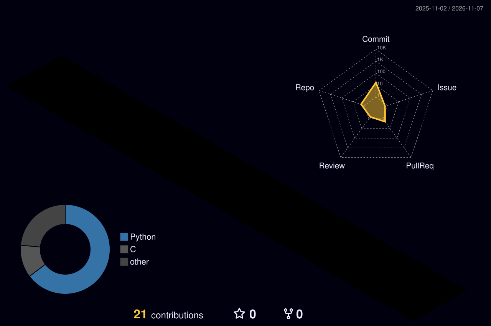

<!-- 🌊 Анимированная шапка -->

  

<!-- ⌨️ Печатающийся текст -->

  

<!-- 👀 Счётчик просмотров + бейджи -->

  
  

---

<!-- 🛠 Иконки технологий в одну анимированную полоску -->
<h3 align="center">⚡ Арсенал</h3>

  

---

<!-- 📊 3D-график коммитов (генерируется GitHub Actions, см. profile-3d.yml) -->
<h3 align="center">📊 Мои коммиты в 3D</h3>

  <picture>
    <source media="(prefers-color-scheme: dark)" srcset="https://raw.githubusercontent.com/ltwworker/ltwworker/output/profile-night-rainbow.svg" />
    <source media="(prefers-color-scheme: light)" srcset="https://raw.githubusercontent.com/ltwworker/ltwworker/output/profile-gitblock.svg" />
    
  </picture>

---

<!-- 🐍 Змейка, которая ест твои коммиты (нужен workflow snake.yml, см. ниже) -->
<h3 align="center">🐍 Змейка ест мои коммиты</h3>

  <picture>
    <source media="(prefers-color-scheme: dark)" srcset="https://raw.githubusercontent.com/ltwworker/ltwworker/output/snake-dark.svg" />
    <source media="(prefers-color-scheme: light)" srcset="https://raw.githubusercontent.com/ltwworker/ltwworker/output/snake.svg" />
    
  </picture>

<!-- 🌊 Подвал -->

  

